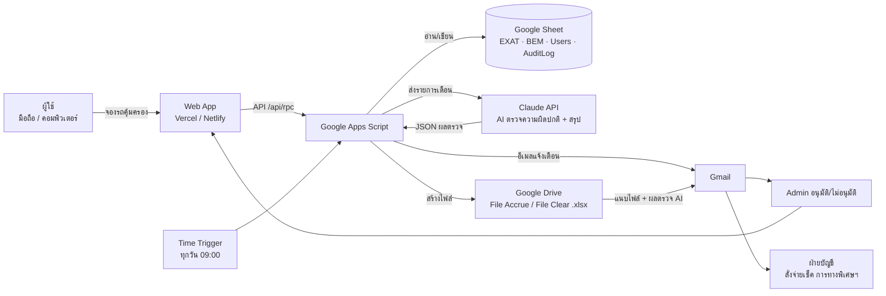

# Protection Fee — หลักฐานประกอบ AI Literacy Gate (Level 4 AI Integrator)

เอกสารนี้จับคู่เกณฑ์ใน **AI_Literacy_Gate_Checklist** (ชีท `Gate_Checklist`) กับสิ่งที่ระบบ Protection Fee มีจริง และบอกว่าต้องเตรียมหลักฐานอะไรเพิ่มก่อนประเมิน

> หลัก Progressive Gate: ต้องผ่าน **ทุกข้อ** ของ L2 และ L3 ก่อน จึงจะนับ L4 ได้ — L4 มี 5 ข้อ ต้องผ่านครบทั้ง 5

## สรุปสถานะ

| Level | ข้อ | สถานะ | สิ่งที่ต้องทำก่อนประเมิน |
|---|---|---|---|
| L2 AI Explorer | 1–4 | พร้อม | ใส่ตัวเลขเวลาก่อน–หลังจริงในตาราง [ก่อน–หลัง](#ก่อนหลัง-l24-l34-l53) |
| L3 AI Player | 1 Prompt มีโครงสร้าง | พร้อม | แนบตัวอย่าง Prompt จาก [ตัวอย่าง Prompt](#ตัวอย่าง-prompt-ที่มีโครงสร้าง-l31) |
| | 2 หลายเครื่องมือ/หลายขั้น | พร้อม | — |
| | 3 ตรวจสอบ AI Output | พร้อม | แนบผลเทียบเดือน ส.ค. 69 (57,600 บาท) |
| | 4 เทียบก่อน–หลัง | ต้องกรอกตัวเลข | กรอกเวลาเดิมที่ทำมือ |
| L4 AI Integrator | 1 Workflow เชื่อมหลาย Tool/Data | พร้อม | แนบแผนภาพ [Workflow](#workflow-l41) |
| | 2 จุดเชื่อมอัตโนมัติ + หลักฐาน | พร้อม | แคปหน้าจอ Trigger + Script Properties (ซ่อน key) |
| | 3 Automated มากกว่า Manual | พร้อม | ใช้ตาราง [ขั้นตอน](#ขั้นตอน-automated-vs-manual-l43) |
| | 4 อธิบาย Logic ได้เอง | **ผู้นำเสนอต้องซ้อม** | ซ้อมตอบ [คำถามเจาะ](#คำถามเจาะที่ควรซ้อม-l44-l5) |
| | 5 สาธิต/หลักฐานจริง | พร้อม | เตรียม AuditLog, ประวัติส่ง, อีเมลที่ได้รับจริง, ไฟล์ xlsx |

**จุดที่เสี่ยงที่สุดคือ "AI อยู่ตรงไหนใน Workflow"** — ก่อนหน้านี้ AI ถูกใช้แค่ตอน *สร้าง* ระบบ (Claude Code / Claude Design) ตอนระบบทำงานจริงไม่มีขั้น AI จึงเพิ่มขั้น **AI ตรวจรายการก่อนส่ง (Claude API)** เข้าไปใน Workflow ตอนรันจริง (ดูข้อ 6 ใน Workflow)

## Workflow (L4.1)



1. ผู้ใช้จองรถคุ้มครองผ่านเว็บ (มือถือ/คอม, ติดตั้งเป็นแอป PWA ได้)
2. เว็บเรียก Google Apps Script ผ่าน API แล้วเขียนลง Google Sheet
3. ระบบส่งอีเมลแจ้ง Admin อัตโนมัติทุกครั้งที่มีการจอง/ยกเลิก
4. Admin อนุมัติ → ระบบเขียนแถวลงตาราง EXAT/BEM และส่งอีเมลยืนยันให้ผู้จอง
5. Time Trigger รันทุกวัน 09:00 เช็กว่าวันนี้เป็นวันส่ง (File Accrue วันที่ 21, 25, 27, 30, 31 · File Clear วันที่ 25)
6. **AI ตรวจรายการ (Claude API)**: ส่งรายการของเดือนให้ Claude หาความผิดปกติ (ซ้ำ, ค่าอาหาร 400 ผิดกฎ, ข้อมูลขาด, สายทางไม่อยู่ใน 3 สาย, จำนวนผิดปกติเทียบเดือนก่อน) และเขียนสรุปภาษาไทย
7. โค้ดตรวจผลจาก AI อีกชั้น (ตัดแถวที่ AI อ้างแต่ไม่มีจริง) — **ตัวเลขยอดเงินทุกตัวคำนวณด้วยโค้ด ไม่ใช่ AI**
8. สร้างไฟล์ .xlsx ใน Drive แล้วส่งอีเมลพร้อมไฟล์แนบและผลตรวจ AI — ถ้า AI ล่มระบบยังส่งได้ตามปกติ และบันทึกเหตุลง AuditLog

## จุดเชื่อมอัตโนมัติ (L4.2)

| จุดเชื่อม | เครื่องมือ | หลักฐานที่ต้องแคป |
|---|---|---|
| เว็บ → Apps Script | API (`/api/rpc`, Web App URL) | Network tab ตอนกดบันทึก หรือ log บน Vercel |
| Apps Script → Google Sheet | Script (SpreadsheetApp) | แถวใหม่ในชีท + AuditLog แถวเดียวกัน |
| Apps Script → Gmail | Script (MailApp) | อีเมล `[รอการอนุมัติ]`, `[อนุมัติแล้ว]` ที่ได้รับจริง |
| ตั้งเวลาส่งไฟล์ | Apps Script Time Trigger | หน้า Triggers ใน Apps Script (ทุกวัน 09:00) |
| Apps Script → Claude API | Script (UrlFetchApp) | AuditLog `ai_check` (model, tokens, จำนวนจุดผิดปกติ) |
| Apps Script → Drive | Script (DriveApp, export xlsx) | ไฟล์ File Accrue / File Clear ในโฟลเดอร์ Drive |
| GitHub → Vercel / Netlify | CI/CD (push แล้ว deploy เอง) | หน้า Deployments |

## ขั้นตอน Automated vs Manual (L4.3)

| ขั้นตอน | แบบ |
|---|---|
| กรอกฟอร์มจอง | Manual (ผู้ใช้) |
| บันทึกลงชีท, เลขลำดับ, ตรวจข้อมูล | Automated |
| แจ้งเตือน Admin ทางอีเมล | Automated |
| อนุมัติ / ไม่อนุมัติ | Manual (Admin กดยืนยัน) |
| เขียนแถว EXAT/BEM, อีเมลยืนยันผู้จอง | Automated |
| ตรวจวันส่ง, ตรวจว่าข้อมูลเปลี่ยนไหม | Automated |
| AI ตรวจความผิดปกติ + สรุป | Automated |
| คำนวณยอดตามสายทาง (จำนวน − ค่าอาหาร) | Automated |
| สร้างไฟล์ xlsx + ส่งอีเมล File Accrue / File Clear | Automated |
| บันทึก AuditLog / ประวัติส่ง | Automated |

Automated 9 ขั้น · Manual 2 ขั้น (กรอกฟอร์ม, อนุมัติ)

## หลักฐานที่ระบบสร้างเอง (L4.5)

- **AuditLog** (แท็บในชีท): ทุกการจอง อนุมัติ ยกเลิก ส่งอีเมล และ `ai_check`
- **ประวัติส่ง File Accrue / File Clear** (แท็บในชีท + หน้าเว็บ): วันที่ส่ง เดือน ผลการส่ง
- **อีเมลจริง** ใน Gmail ของผู้รับ
- **ไฟล์ xlsx จริง** ในโฟลเดอร์ Drive
- **Git history** ใน GitHub (ทุกการแก้ไขมีบันทึก)

สาธิตสด: จองด้วยบัญชีผู้ใช้ → แสดงอีเมลถึง Admin → อนุมัติ → แสดงอีเมลยืนยัน → เปิดหน้า File Clear กด "ให้ AI ตรวจตอนนี้" → เปิด AuditLog

## การตรวจสอบ AI Output (L3.3)

- **ตัวเลขยอดเงิน**: เทียบ File Clear เดือน ส.ค. 69 ที่ระบบสร้างจากข้อมูลจริงกับไฟล์ที่ทำมือ ตรงกันทุกสายทาง

  | สายทาง | ไฟล์ทำมือ | ระบบ |
  |---|---|---|
  | ฉลองรัช | 5,600 | 5,600 |
  | เฉลิมมหานคร | 43,400 | 43,400 |
  | ศรีรัช | 8,600 | 8,600 |
  | **รวม** | **57,600** | **57,600** |

- **โค้ดที่ AI เขียน**: ทดสอบกับชีทจำลอง (mock) ทุกฟีเจอร์ก่อนขึ้นระบบจริง เช่น สมัคร/อนุมัติ, ล็อกบัญชีหลังใส่รหัสผิด, สิทธิ์ admin/user, การแจ้งเตือนอีเมล
- **ผลตรวจจาก Claude ตอนรันจริง**: โค้ดตัดผลที่อ้างแถวไม่มีจริง และไม่ใช้ตัวเลขจาก AI
- **งานที่ไม่ให้ AI ทำ**: คำนวณยอดเงิน, อนุมัติการจอง, ตัดสินใจส่งเช็ค — ให้โค้ดและคนทำ

## เครื่องมือ AI ที่ใช้ (L2.1, L3.2)

| เครื่องมือ | ใช้ทำอะไร | ผลลัพธ์ |
|---|---|---|
| Claude Design | ออกแบบหน้าจอ (เข้าสู่ระบบ, สมัคร, บันทึก, สถานที่, ผู้ใช้) | Canvas หน้าจอ 5 หน้า |
| Claude Code | เขียนโค้ดเว็บ + Apps Script, ทดสอบ, deploy | ระบบที่ใช้งานจริงบน Vercel / Netlify |
| Claude (claude.ai) | ทำ Demo ให้ทีมลองก่อนสร้างจริง | Demo กดใช้ได้ |
| Claude API | ตรวจความผิดปกติก่อนส่งไฟล์ (ตอนระบบรันจริง) | ผลตรวจในอีเมล + AuditLog |

## ตัวอย่าง Prompt ที่มีโครงสร้าง (L3.1)

Prompt ที่ใช้สร้าง File Clear (Context / Instruction / Format):

```
Context:  File Clear คือไฟล์สรุปค่ารถคุ้มครองของเดือนก่อน ใช้สั่งจ่ายเช็คให้การทางพิเศษฯ
          ตัวอย่างไฟล์จริงอยู่ที่ File Clear/ (ม.ค.–ส.ค. 69)
Instruction: ส่งไฟล์ของเดือนก่อนหน้า ทุกวันที่ 25 ของเดือน ให้ teraporn.ru@… และ CC ผู้เกี่ยวข้อง
Format:   อีเมล  เรียน น้องหม่อง / สำเนา ผู้เกี่ยวข้อง / เรื่อง นำส่ง File Clear ค่ารถคุ้มครอง เดือน … ปี 2569
          รายละเอียด: ยอดแยกตามสายทาง ฉลองรัช / เฉลิมมหานคร / ศรีรัช และยอดรวม
```

## ก่อน–หลัง (L2.4, L3.4, L5.3)

> กรอกตัวเลขจริงของทีมในช่อง [ ]

| งาน | ก่อน (ทำมือ) | หลัง (ระบบ) |
|---|---|---|
| จองรถคุ้มครอง | แจ้งทางแชต/โทร, จดลงชีทเอง [ ] นาที/ครั้ง | กรอกฟอร์มในมือถือ [ ] นาที, แจ้ง Admin อัตโนมัติ |
| อนุมัติ | ตามถามทีละคน | กดอนุมัติจากลิงก์ในอีเมล ผู้จองได้อีเมลยืนยันเอง |
| ทำ File Accrue | รวมยอดเองทุกเดือน [ ] ชม. | ระบบสร้าง + ส่งเอง 5 รอบ/เดือน เฉพาะเมื่อข้อมูลเปลี่ยน |
| ทำ File Clear | ทำไฟล์ + เขียนอีเมลเอง [ ] ชม. | ส่งเองทุกวันที่ 25 ยอดตรงกับไฟล์ทำมือ |
| ตรวจความถูกต้อง | ตรวจด้วยตา | AI ช่วยชี้จุดผิดปกติ + โค้ดคำนวณยอด |
| บทบาทคน | คนทำทุกขั้น | คนกรอก + อนุมัติ, ที่เหลือระบบทำ |

## คำถามเจาะที่ควรซ้อม (L4.4, L5)

1. **ถ้าดึง AI ออก ระบบยังทำงานได้ไหม** — ได้ การจอง อนุมัติ คำนวณยอด และส่งไฟล์ยังทำงานครบ เพราะตัวเลขคำนวณด้วยโค้ด ที่หายไปคือการตรวจความผิดปกติ + สรุปภาษาไทยจาก AI (ข้อนี้ทำให้ L5.1 ยังไม่ผ่าน ซึ่งไม่กระทบ L4)
2. **ถ้า Input เปลี่ยนรูปแบบ จุดเชื่อมยังทำงานไหม** — Apps Script หาตารางจากหัวคอลัมน์ ไม่ผูกกับตำแหน่ง ถ้าเพิ่มคอลัมน์ยังทำงานได้ ถ้าเปลี่ยนชื่อหัวคอลัมน์ ระบบจะแจ้งว่าหาตารางไม่เจอ
3. **ถ้า AI ล่มหรือตอบผิด** — ระบบส่งไฟล์ต่อโดยไม่มีส่วน AI และบันทึกใน AuditLog; ผลที่อ้างแถวไม่มีจริงจะถูกตัดทิ้ง
4. **ทำไมส่งซ้ำไม่ได้** — มี lock กันรันซ้อน และเช็กว่าข้อมูลเดือนนั้นเปลี่ยนไหมก่อนส่ง
5. **ใครเห็นอะไร** — user เห็นเฉพาะตารางจอง/รายการยกเลิก/สถานที่/บัญชีของฉัน; admin เห็นทั้งหมด และเซิร์ฟเวอร์ตรวจสิทธิ์ซ้ำ
6. **ทีมอื่นนำไปใช้ได้ไหม (L5.4)** — มีคู่มือใช้งาน (.pptx), README ติดตั้ง/deploy Vercel และ Netlify, Demo ให้ลองก่อน

## Level 5 (ถ้าจะไปต่อ)

| ข้อ | สถานะ | ต้องทำ |
|---|---|---|
| 5.1 AI เป็นแกนของ Process | ยังไม่ผ่าน | Process เดิมถูกทำให้อัตโนมัติ AI เป็นตัวตรวจเสริม |
| 5.2 ทำหลายขั้นเองโดยไม่มีคนกำกับ | มีลุ้น | Trigger → AI ตรวจ → สร้างไฟล์ → ส่งอีเมล ทำต่อเนื่องเอง |
| 5.3 บทบาทคนเปลี่ยน | มีลุ้น | ใช้ตารางก่อน–หลัง + ตัวเลขจริง |
| 5.4 ส่งต่อทีมอื่น / Scale | ต้องมีหลักฐาน | ให้ทีม/แผนกอื่นลองใช้จริงแล้วเก็บหลักฐาน |
